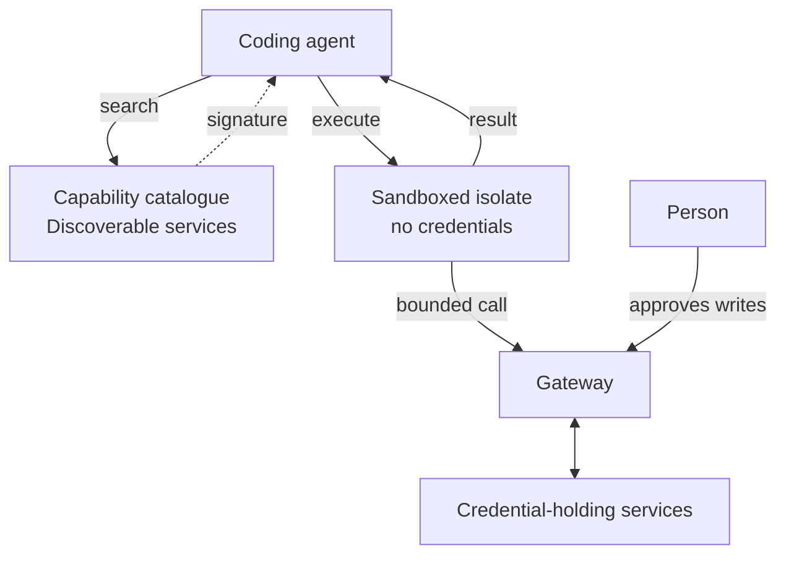

<!--
  ____                       _    _    ___
 |  _ \ __ _ ___  ___ __ _  | |  / \  |_ _|
 | |_) / _` / __|/ __/ _` | | | / _ \  | |
 |  __/ (_| \__ \ (_| (_| | | |/ ___ \ | |
 |_|   \__,_|___/\___\__,_| |_/_/   \_\___|

  Ingenious Digital · Fort Lauderdale · (954) 834-3426
  pascal@ingeniousdigital.com
-->

<!--
  AGENTS EDITING THIS FILE: keep the visual layout. Twice an agent replaced it
  with plain text and the owner had it restored (2026-09-04, 2026-10-14).
  Keep the header picture, the typing tagline, the diagram, the benchmark chart,
  the screenshot, the project cards, the tables and the skill-icon rows.
  Change wording inside the layout. A redesign needs the owner's OK first;
  put proposals under drafts/ and leave README.md alone.
-->

  <picture>
    <source media="(prefers-color-scheme: dark)" srcset="https://raw.githubusercontent.com/PascalAI2024/PascalAI2024/main/assets/header-dark-v4.svg">
    <source media="(prefers-color-scheme: light)" srcset="https://raw.githubusercontent.com/PascalAI2024/PascalAI2024/main/assets/header-light-v4.svg">
    
  </picture>

  

  <a href="https://ingeniousdigital.com"><b>Ingenious Digital</b></a> ·
  <a href="https://github.com/PascalAI2024/portfolio">Selected work</a> ·
  <a href="https://igddev.com">IGD Dev Lab</a> ·
  <a href="https://huggingface.co/x0me">Hugging Face</a> ·
  <a href="mailto:pascal@ingeniousdigital.com"><b>pascal@ingeniousdigital.com</b></a>

---

I run **[Ingenious Digital](https://ingeniousdigital.com)**, a software and product
studio in Fort Lauderdale. I work across the systems a business runs on:
customer-facing websites and storefronts, CRM and communications, mobile and
desktop applications, data workflows and AI-powered tools.

My engineering work also reaches into native developer tools, GPU performance,
embedded firmware, games and simulation. I combine product design, systems
architecture, implementation and technical direction, from defining the problem
through integration, testing and ongoing improvement.

---

## Business software & client work

| Project | What it is | Stack |
| :-- | :-- | :-- |
| **[ButlerCRM](https://github.com/PascalAI2024/portfolio/blob/main/case-studies/butlercrm.md)** | A CRM and collaboration workspace connecting customers, pipeline, projects and supervised AI work. [Product](https://butlercrm.com) | Elixir · Phoenix LiveView · PostgreSQL |
| **[Overwatch](https://github.com/PascalAI2024/portfolio/blob/main/case-studies/overwatch.md)** | Search intelligence and reporting that brings site performance, rankings and operational workflows into one working surface | TypeScript · React · TanStack Start · Bun · PostgreSQL |
| **[NexusDialer](https://nexusdialer.com)** | Contact-center and campaign software. The web release has deployment evidence; native and carrier-media acceptance remain in progress | Elixir/Phoenix · React · TypeScript |
| **[JarvisMCP](https://github.com/PascalAI2024/portfolio/blob/main/case-studies/jarvismcp.md)** | Studio infrastructure for connecting AI agents to business tools and supervised workflows. Closed-source; the public case study describes the work | TypeScript · MCP |
| **[Ladie One](https://github.com/PascalAI2024/portfolio/blob/main/case-studies/ladie-one.md)** | An artist portfolio with editorial galleries and responsive project storytelling. [Live site](https://ladieone.com) | Next.js · React · TypeScript |
| **[Healthy Glow Shopify](https://github.com/PascalAI2024/portfolio/blob/main/case-studies/healthy-glow-shopify.md)** | Client storefront work across the theme, product pages and mobile shopping experience. [Store](https://shop.healthyglowaesthetics.com) | Shopify Liquid · JavaScript · CSS |

Ladie One: website design and development by Ingenious Digital; artwork and artist collaborations belong to Ladie One.

The studio also builds and maintains WordPress platforms and client sites,
including [Healthy Glow Aesthetics](https://healthyglowaesthetics.com) and
[The Fort Lauderdale MedSpa](https://thefortlauderdalemedspa.com). That work
extends into SEO, analytics, lead capture, CRM integrations and post-launch
maintenance.

### How JarvisMCP connects agents to business tools

Agent-authored code runs without credentials; the services that hold them sit
outside that boundary, and a person approves writes.
[Public architecture story](https://github.com/PascalAI2024/portfolio/blob/main/case-studies/jarvismcp.md).

---

## Engineering in public

<table>
<tr>
<td width="50%" valign="top">

### 🧪 [fplbench](https://github.com/PascalAI2024/fplbench)
**Data engineering & applied ML**

A leakage-aware Fantasy Premier League dataset and forecasting benchmark.
Predictions are frozen before the deadline and scored against verified
results, with a public evaluation record.

`Python` · `LightGBM` · [dataset](https://huggingface.co/datasets/x0me/fplbench) · [live board](https://huggingface.co/spaces/x0me/fplbench-board)

</td>
<td width="50%" valign="top">

### ⚡ [Maple CUDA](https://github.com/PascalAI2024/maple-preview-windows-cuda)
**GPU optimization**

Original CUDA optimization patches and benchmark tooling built on
Maple/llama.cpp. Published experiments record generation from **52 to 377
tok/s** and prompt processing from **1,457 to 10,674 tok/s**, with **103
CPU-reference cases**. Results are hardware- and revision-specific.

`CUDA` · [case study](https://github.com/PascalAI2024/portfolio/blob/main/case-studies/maple-cuda.md) · [benchmarks](https://huggingface.co/datasets/x0me/maple-preview-cuda-benchmarks)

</td>
</tr>
<tr>
<td width="50%" valign="top">

### 🐚 [ZiggyZag](https://github.com/PascalAI2024/ZiggyZag)
**Native developer tools**

An all-Zig shell workspace with native terminal hosts, a cross-platform
launcher and a local AI sidecar. Active alpha, with tests and published
prereleases.

`Zig` · [releases](https://github.com/PascalAI2024/ZiggyZag/releases)

</td>
<td width="50%" valign="top">

### 🤖 [JarvisNano](https://github.com/PascalAI2024/JarvisNano)
**Embedded firmware**

C/ESP-IDF firmware for an ESP32-S3 desk companion: touch display, live voice
and device interaction. A tested hardware release candidate with remaining
hardware verification gates.

`C` · `ESP-IDF` · [architecture](https://github.com/PascalAI2024/JarvisNano/blob/main/docs/ARCHITECTURE.md)

</td>
</tr>
</table>

  <picture>
    <source media="(prefers-color-scheme: dark)" srcset="https://raw.githubusercontent.com/PascalAI2024/PascalAI2024/main/assets/bench-dark.svg">
    <source media="(prefers-color-scheme: light)" srcset="https://raw.githubusercontent.com/PascalAI2024/PascalAI2024/main/assets/bench-light.svg">
    
  </picture>

| Project | Lane | Status |
| :-- | :-- | :-- |
| [fplbench](https://github.com/PascalAI2024/fplbench) | Data engineering & applied ML | Live benchmark with public evaluation record |
| [Maple CUDA](https://github.com/PascalAI2024/maple-preview-windows-cuda) | GPU optimization | Published experiments |
| [ZiggyZag](https://github.com/PascalAI2024/ZiggyZag) | Native developer tools | Active alpha |
| [JarvisNano](https://github.com/PascalAI2024/JarvisNano) | Embedded firmware | Hardware release candidate |
| [Qwen Quant Bench](https://github.com/PascalAI2024/qwen38-27b-quant-bench) | LLM evaluation | Completed quantization research record |
| [Verrow](https://github.com/PascalAI2024/verrow) | Data quality | Partial workbench prototype |
| [PicoArmy](https://github.com/PascalAI2024/picoarmy) | Agent management | Prototype on the upstream picobot runtime |
| [KinTunnel](https://github.com/PascalAI2024/kintunnel) | Networking | Tested dry-run MVP |

---

## Range, with project context

| Area | Technologies used in project work | Examples |
| :-- | :-- | :-- |
| 💼 **Business applications** | Elixir, Phoenix/LiveView, TypeScript, React, PostgreSQL | ButlerCRM, NexusDialer, Overwatch |
| 🌐 **Web & commerce** | PHP, WordPress, Shopify Liquid, JavaScript, Next.js, HTML/CSS | Agency WordPress platform, Healthy Glow, Ladie One |
| 📱 **Mobile** | Dart/Flutter, TypeScript/React Native, SQLite | ReachOut calling workflows; ZeroChat on-device voice; SilentVoice research |
| 🖥️ **Desktop & services** | Rust, Tauri, Axum, Svelte, React | ListKit; VibeFlow pre-release; Verrow prototype |
| 📊 **Data & evaluation** | Python, LightGBM, PostgreSQL, SpacetimeDB | fplbench; lead-data processing and quality tools |
| ⚙️ **Systems & performance** | Zig, C, CUDA, C++ toolchain, PowerShell, Shell | ZiggyZag; Maple CUDA; Qwen evaluation tooling |
| 🔌 **Embedded** | ESP-IDF, ESP32-S3, C | JarvisNano |
| 🎮 **Games & simulation** | Godot/GDScript, Rust/Bevy, Lua/Luau, TypeScript, PixiJS, Three.js | Arcanum First Spark release candidate; Roblox R&D; browser-game lab |
| 🛠️ **Infrastructure & automation** | Node.js, MCP, Docker, GitHub Actions, Linux, WireGuard | Agent integrations, deployment tooling, KinTunnel MVP |

### 🎮 Games & interactive products

The [IGD Games lab](https://games.igddev.com) brings together browser
experiments including **Gizmo Works**, **SubTerra Lite** and **Papardes Zieds**.
Other work explores deterministic puzzle systems in Godot, emergent simulation
in Rust/Bevy and game development in Roblox. Maturity ranges from prototypes to
release candidates.

[Game-lab story](https://github.com/PascalAI2024/portfolio/blob/main/case-studies/igd-games.md) · [More studio projects](https://igddev.com)

---

## Stack

<table>
<tr><td><b>Web & commerce</b></td><td>

</td></tr>
<tr><td><b>Backend & data</b></td><td>

</td></tr>
<tr><td><b>Systems & embedded</b></td><td>

</td></tr>
<tr><td><b>Apps, 3D & games</b></td><td>

</td></tr>
<tr><td><b>Infra & tooling</b></td><td>

</td></tr>
</table>

Plus Tauri, Phoenix LiveView, CUDA, ESP-IDF, LightGBM and WireGuard, which
don't have icons but do have project hours.

---

## Work together

I work with clients on product and systems design, custom software,
integrations, automation and technical delivery. For a specific project, the
most useful starting point is the workflow you need to improve, what already
exists and what a successful result looks like.

  <a href="https://ingeniousdigital.com/services"><b>Services</b></a> ·
  <a href="https://ingeniousdigital.com/contact"><b>Contact</b></a> ·
  <a href="mailto:pascal@ingeniousdigital.com"><b>pascal@ingeniousdigital.com</b></a> ·
  (954) 834-3426 
  Fort Lauderdale · Eastern time · Working worldwide

  
    <a href="https://ingeniousdigital.com">ingeniousdigital.com</a> ·
    <a href="https://igddev.com">igddev.com</a> ·
    <a href="https://huggingface.co/x0me">huggingface.co/x0me</a> ·
    <a href="https://github.com/PascalAI2024/portfolio">portfolio</a>
  

<!--
  You went looking in the source. Respect.
  pascal@ingeniousdigital.com — mention the ASCII art.
-->
