

  <picture>
    <source media="(prefers-color-scheme: dark)" srcset="https://raw.githubusercontent.com/PascalAI2024/PascalAI2024/main/assets/header-dark-v4.svg">
    <source media="(prefers-color-scheme: light)" srcset="https://raw.githubusercontent.com/PascalAI2024/PascalAI2024/main/assets/header-light-v4.svg">
    
  </picture>

  

  <a href="https://ingeniousdigital.com"><b>Ingenious Digital</b></a> ·
  <a href="https://github.com/PascalAI2024/portfolio">Selected work</a> ·
  <a href="https://labs.ingeniousdigital.com">IGD Dev Lab</a> ·
  <a href="https://huggingface.co/x0me">Hugging Face</a> ·
  <a href="mailto:pascal@ingeniousdigital.com"><b>pascal@ingeniousdigital.com</b></a>

---

# Pascal

I'm **Pascal**. I run **[Ingenious Digital](https://ingeniousdigital.com)**, a software and product studio based in Fort Lauderdale. I bring together product thinking, hands-on engineering and technical leadership: from client websites and commerce to CRM, mobile apps, AI infrastructure, data, games and low-level systems.

I like taking an idea from the first useful question through architecture, design, implementation and ongoing improvement. The work below includes my own builds and studio projects made with collaborators; each description identifies my role where it matters.

---

## The studio in 73 seconds

<a href="https://www.youtube.com/watch?v=_apSy5T-q_0">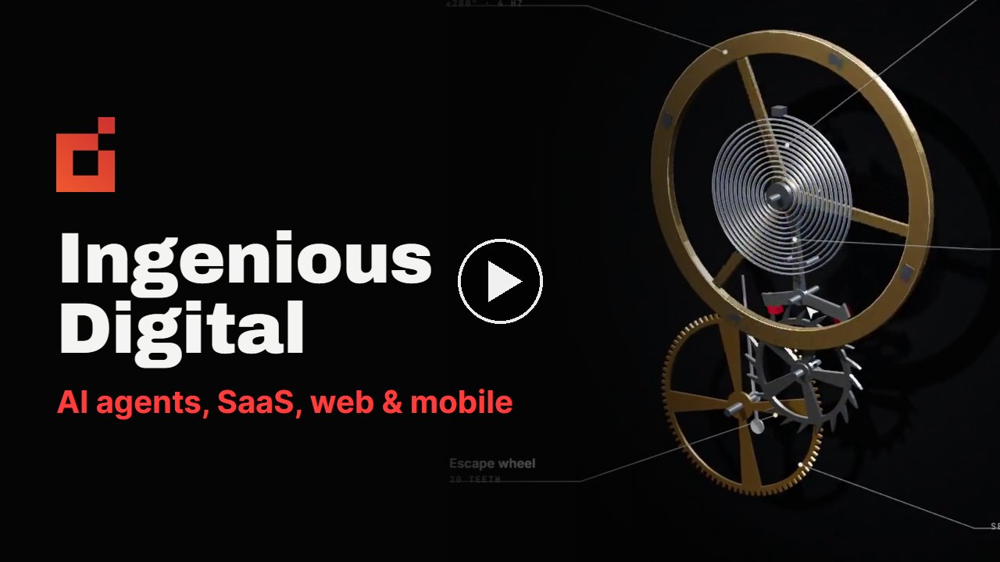</a>

A short film of the studio's work: mobile apps, client sites and stores, AI platforms and a working watch escapement. [Watch it on YouTube](https://www.youtube.com/watch?v=_apSy5T-q_0). The [ingeniousdigital.com](https://ingeniousdigital.com) homepage shows 29 more real screens: client sites, our web apps and our Android apps.

---

## Tools I work with

**Web & commerce** · WordPress, Shopify, PHP, JavaScript, TypeScript, React, Next.js, Tailwind, HTML, CSS 

**Backend & data** · Elixir, Node.js, Bun, Python, PostgreSQL, SQLite, FastAPI, Phoenix LiveView, SpacetimeDB, LightGBM 

**Systems & embedded** · Rust, Zig, C, C++, CUDA, ESP-IDF, workerd 

**Apps, games & graphics** · Flutter, Dart, Godot, Three.js, Svelte, Luau, Tauri, React Native 

**Infrastructure & tools** · Docker, GitHub Actions, Linux, Bash, PowerShell, Git, Cloudflare, MCP, WireGuard 

---

[Film](#the-studio-in-73-seconds) · [Tools](#tools-i-work-with) · [Products](#products-and-systems) · [3D](#interactive-3d) · [Mobile apps](#mobile-apps) · [Game lab](#igd-game-labs) · [Client websites](#client-websites) · [Research](#data-research-and-engineering)

## Products and systems

Studio products and public projects. Screens are from the live apps or demo data; each links to its case study or repository.

<table>
  <tr>
    <td width="50%" valign="top">
      <a href="https://ingeniousdigital.com/work/butler-crm">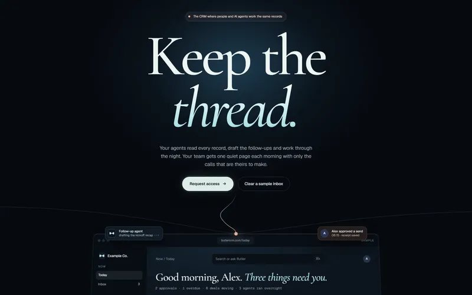</a> 
      <b><a href="https://ingeniousdigital.com/work/butler-crm">ButlerCRM</a></b> 
      Contacts, deals, email, calendar and tasks in one workspace that updates live. Elixir and Phoenix. I designed its architecture.
    </td>
    <td width="50%" valign="top">
      <a href="https://ingeniousdigital.com/work/overwatch">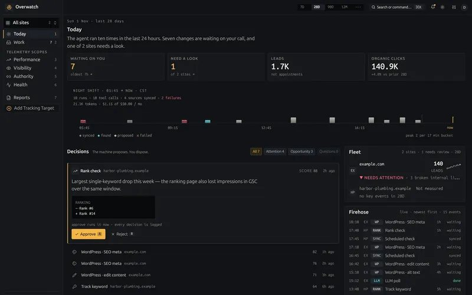</a> 
      <b><a href="https://ingeniousdigital.com/work/overwatch">Overwatch</a></b> 
      Shows how a site is found in search, AI answers and the local map, then proposes fixes. A person approves each one.
    </td>
  </tr>
  <tr>
    <td width="50%" valign="top">
      <a href="https://ingeniousdigital.com/work/nexus-dialer">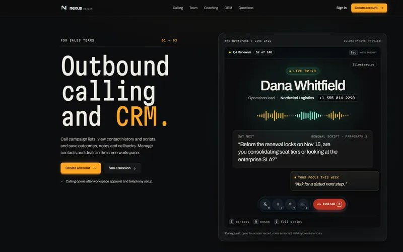</a> 
      <b><a href="https://ingeniousdigital.com/work/nexus-dialer">NexusDialer</a></b> 
      Outbound calling, the contact record and an AI assistant on one screen. Progressive dialing, still being built out.
    </td>
    <td width="50%" valign="top">
      <a href="https://ingeniousdigital.com/work/asteria">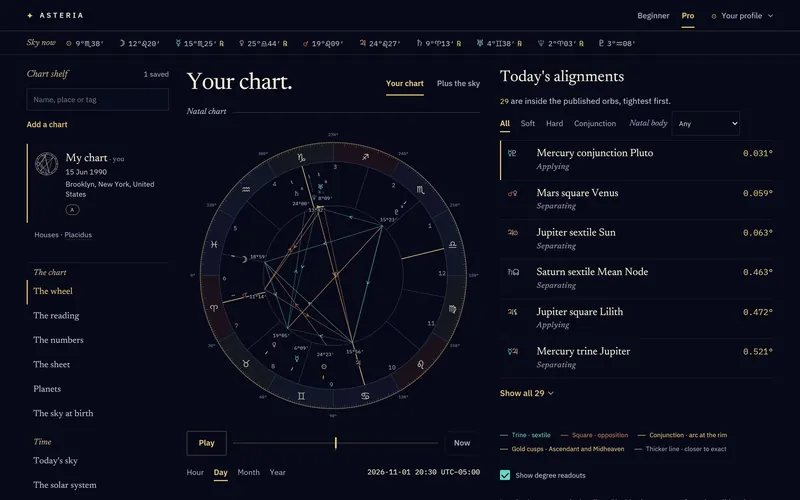</a> 
      <b><a href="https://ingeniousdigital.com/work/asteria">Asteria</a></b> 
      A birth-chart learning product that keeps calculated fact separate from interpretation. Rust engine, React client.
    </td>
  </tr>
  <tr>
    <td width="50%" valign="top">
      <a href="https://ingeniousdigital.com/work/tracekill">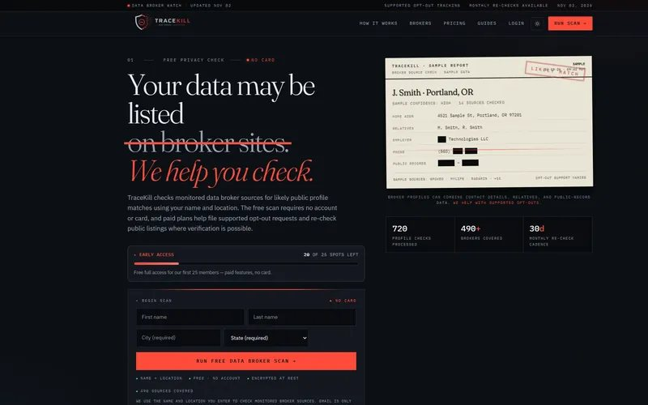</a> 
      <b><a href="https://ingeniousdigital.com/work/tracekill">TraceKill</a></b> 
      Scans data-broker sites for a person's information, files removal requests and keeps checking.
    </td>
    <td width="50%" valign="top">
      <a href="https://ingeniousdigital.com/work/polyhuntr">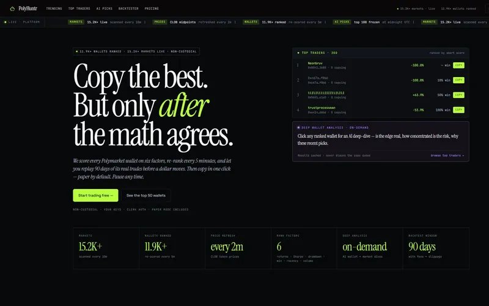</a> 
      <b><a href="https://ingeniousdigital.com/work/polyhuntr">PolyHuntr</a></b> 
      Follows Polymarket, ranks the public wallets worth watching and explains any market or wallet.
    </td>
  </tr>
  <tr>
    <td width="50%" valign="top">
      <a href="https://github.com/PascalAI2024/verrow">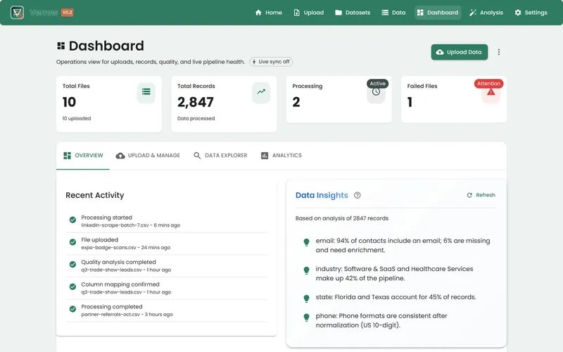</a> 
      <b><a href="https://github.com/PascalAI2024/verrow">Verrow</a></b> 
      A data-quality workbench prototype for raw lead files. Rust CSV ingestion and column mapping are implemented.
    </td>
    <td width="50%" valign="top">
      <a href="https://github.com/PascalAI2024/kintunnel">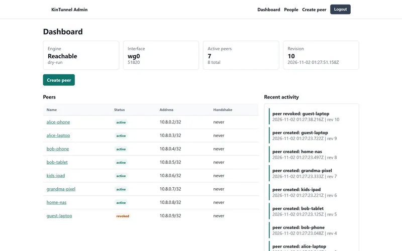</a> 
      <b><a href="https://github.com/PascalAI2024/kintunnel">KinTunnel</a></b> 
      Open-source Docker-native WireGuard manager in TypeScript. A dry-run MVP; live-server validation is open.
    </td>
  </tr>
</table>

### [JarvisMCP](https://github.com/PascalAI2024/portfolio/blob/main/case-studies/jarvismcp.md) · infrastructure for AI agents

Infrastructure connecting AI agents with tools and workflows. Private source; public case study.

### [igd-wp](https://github.com/PascalAI2024/portfolio/blob/main/case-studies/igd-wp.md) · reusable WordPress platform

I led the systems architecture and technical direction for shared capabilities, releases, testing and maintenance across client sites.

## Interactive 3D

### [Swiss lever escapement](https://ingeniousdigital.com/showcase/escapement.html) · a working watch mechanism

<a href="https://ingeniousdigital.com/showcase/escapement.html">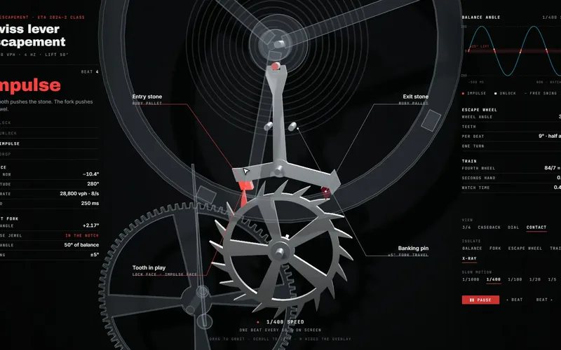</a>

A Three.js model of the lever escapement in an ETA 2824-2 class movement, running at 28,800 beats an hour. Watch time is the only input, and it sets the pose of every part and every gauge. The figures come from published movement data; the sources file marks which values are modelled. [Open the model](https://ingeniousdigital.com/showcase/escapement.html) · [Case study](https://ingeniousdigital.com/work/escapement-simulator)

## Mobile apps

I led CallCue and ZeroInbox with contributions from Biruk and Mati. The two are listed on Google Play; the other apps are in development or testing.

### [CallCue](https://play.google.com/store/apps/details?id=com.ingeniousdigital.callcue) · live on Google Play

A call planner for follow-ups, holidays and contact campaigns.

<a href="https://play.google.com/store/apps/details?id=com.ingeniousdigital.callcue">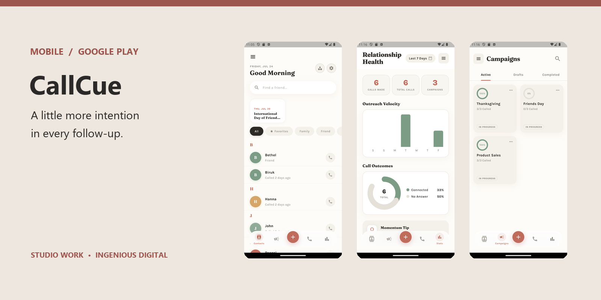</a>

### [ZeroInbox](https://play.google.com/store/apps/details?id=com.igddev.zeroinbox) · live on Google Play

A Flutter Gmail cleanup game: group messages by sender, swipe through them and earn progress as you clear your inbox.

<a href="https://play.google.com/store/apps/details?id=com.igddev.zeroinbox">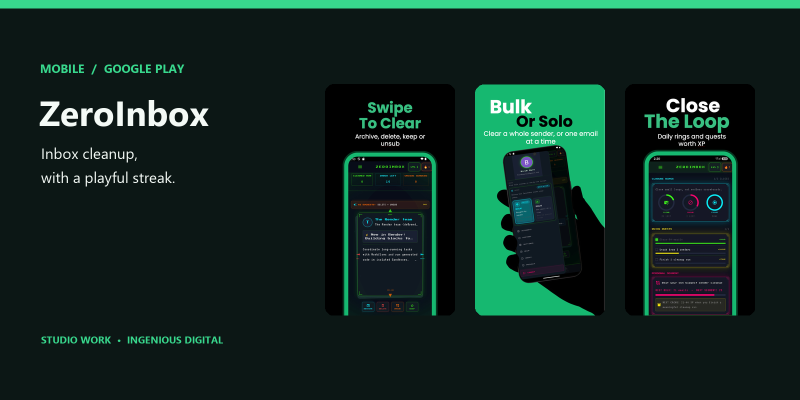</a>

### More mobile work · in development or testing

**[SK8Freak](https://sk8freak.com/)** is a fingerboard community app in development; mobile release unverified.

**[SilentVoice](https://silentvoice.ingeniousdigital.com)** is an offline sign-language research prototype, built with AI agents: a React Native app with on-device MediaPipe hand tracking and a PyTorch training pipeline. Its models reach 59.4% top-1 and 83.2% top-5 on 13,571 held-out sequences of a 250-sign American Sign Language benchmark. That is an offline benchmark result, not real signing. Ethiopian Sign Language recognition is not built yet. ASL data: PopSign, CC BY 4.0.

- **HerCircle** — an app exploring trusted circles and check-ins; public store release unverified.
- **NexusDialer mobile** — a companion communications app in development; public store release unverified.

## IGD Game Labs

The [IGD Games hub](https://games.ingeniousdigital.com/) showcases browser-game experiments. Studio projects include:

<a href="https://games.ingeniousdigital.com/">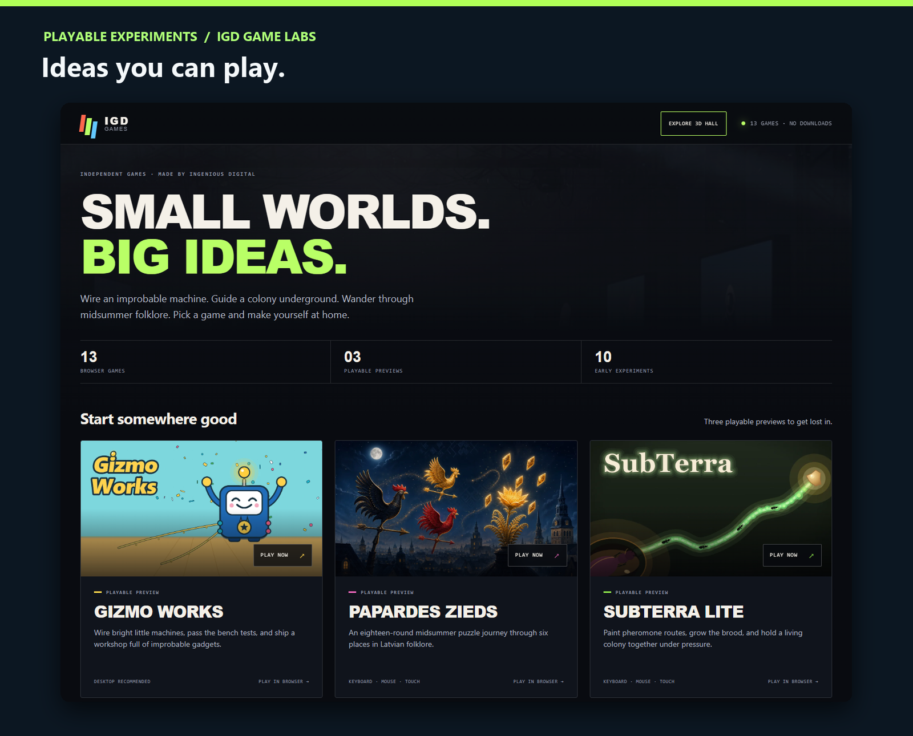</a>

- **Conveyor Idle** — an early warehouse-building prototype featured on the hub.
- **Gizmo Works** — circuit puzzles and working gadgets.
- **SubTerra Lite** — guide an ant colony and its pheromone trails.
- **Papardes Zieds** — puzzles inspired by Latvian folklore.
- **Halligan** — a developing tactical planning prototype.

`TypeScript` · `Phaser` · `PixiJS` · `HTML5` · [Game lab story](https://github.com/PascalAI2024/portfolio/blob/main/case-studies/igd-games.md)

## Client websites

### [Healthy Glow Aesthetics](https://healthyglowaesthetics.com/) · WordPress

Our studio works on this aesthetics practice's WordPress website: service discovery, content, booking pathways, SEO, analytics and ongoing improvements.

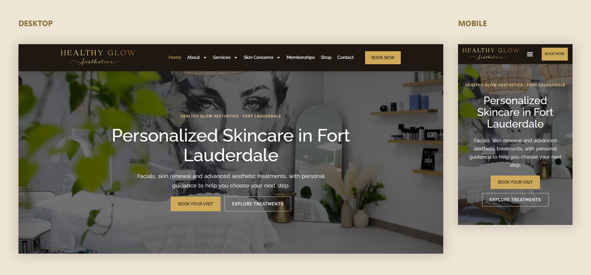

[View desktop capture](assets/showcase/healthy-wordpress-homepage-desktop.png) · [View mobile capture](assets/showcase/healthy-wordpress-homepage-mobile.png)

### [The Fort Lauderdale MedSpa](https://thefortlauderdalemedspa.com/) · WordPress

A separate med spa website built by our studio, with service information and a path to booking.

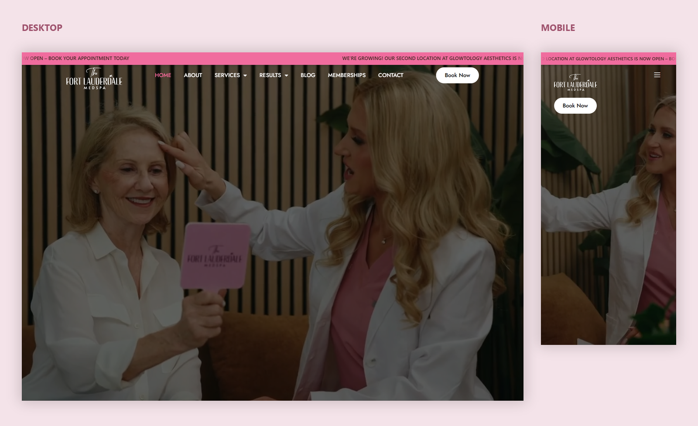

[View desktop capture](assets/showcase/medspa-homepage-desktop.png) · [View mobile capture](assets/showcase/medspa-homepage-mobile.png)

Our local-service website work also includes [Air Duct Cleaning Port St. Lucie](https://airductcleaningpsl.com/) and [Cooling Experts](https://coolingexperts.com/).

## Shopify commerce

### [Healthy Glow Shop](https://shop.healthyglowaesthetics.com/) · Shopify

I led the Shopify build for the Healthy Glow store, connecting its shopping experience to the practice's main website. [Case study](https://github.com/PascalAI2024/portfolio/blob/main/case-studies/healthy-glow-shopify.md)

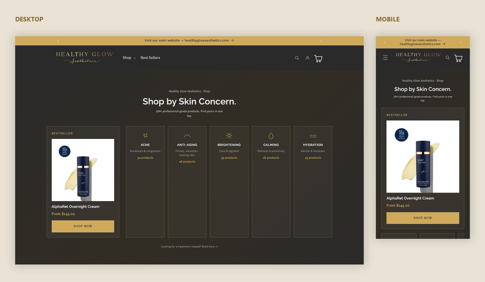

[View desktop capture](assets/showcase/healthy-shopify-homepage-desktop.png) · [View mobile capture](assets/showcase/healthy-shopify-homepage-mobile.png)

## Data, research and engineering

### [Kaggle](https://www.kaggle.com/pascalledesma) · machine learning in the wild

Research and competitions across reasoning, scientific data and agent security. I completed MIT IDSS's Data Science and Machine Learning program in 2025.

### [fplbench](https://github.com/PascalAI2024/fplbench) · forecasts you can score

A leakage-aware Fantasy Premier League dataset and benchmark. Predictions are frozen before the deadline and scored against verified results. `Python` · `LightGBM` · [live board](https://huggingface.co/spaces/x0me/fplbench-board)

### [Maple CUDA](https://github.com/PascalAI2024/maple-preview-windows-cuda) · measuring the fast path

CUDA optimization and benchmark tooling for Maple/llama.cpp. [Benchmarks](https://huggingface.co/datasets/x0me/maple-preview-cuda-benchmarks)

  <picture>
    <source media="(prefers-color-scheme: dark)" srcset="https://raw.githubusercontent.com/PascalAI2024/PascalAI2024/main/assets/bench-dark.svg">
    <source media="(prefers-color-scheme: light)" srcset="https://raw.githubusercontent.com/PascalAI2024/PascalAI2024/main/assets/bench-light.svg">
    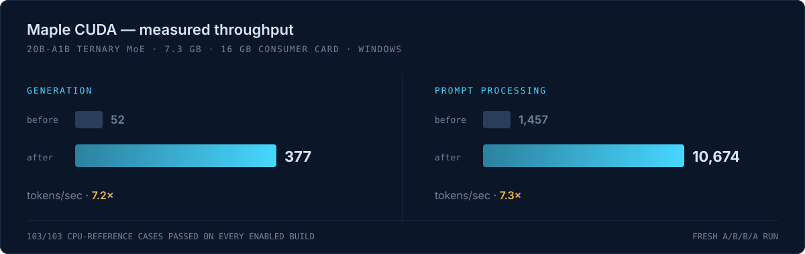
  </picture>

### [JarvisNano](https://github.com/PascalAI2024/JarvisNano) · a voice-first desk companion

ESP32-S3 firmware with a touch display, in C on ESP-IDF. The hardware verification gates are still open.

### [ZiggyZag](https://github.com/PascalAI2024/ZiggyZag) · a native Zig shell

An alpha shell workspace with native terminal hosts, a cross-platform launcher and a local AI sidecar. `Zig`

| More public work | Focus |
| :-- | :-- |
| [Qwen Quant Bench](https://github.com/PascalAI2024/qwen38-27b-quant-bench) | Model evaluation |
| [Selected engineering portfolio](https://github.com/PascalAI2024/portfolio) | Case studies and architecture |

---

## Keep learning

[AI Fluency for Builders](https://verify.skilljar.com/c/me57yu2mc7sq) · [Claude Code in Action](https://verify.skilljar.com/c/d63sf2hoo6gt) · [Introduction to Model Context Protocol](https://verify.skilljar.com/c/jbf57tmrpdb6)

## Let's build something useful

[Ingenious Digital](https://ingeniousdigital.com) · [Selected work](https://github.com/PascalAI2024/portfolio) · [IGD Dev Lab](https://labs.ingeniousdigital.com) · [Kaggle](https://www.kaggle.com/pascalledesma) · [Hugging Face](https://huggingface.co/x0me) · [Email Pascal](mailto:pascal@ingeniousdigital.com)

Fort Lauderdale · working worldwide

