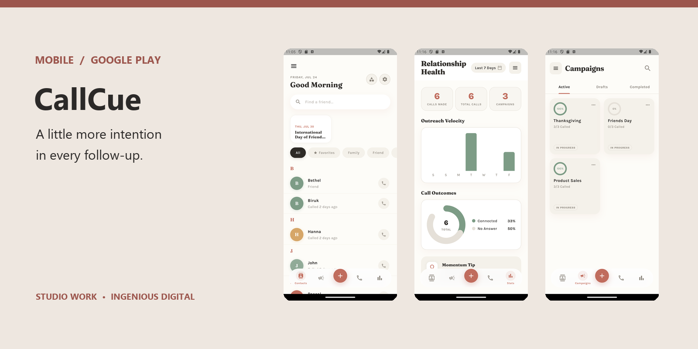
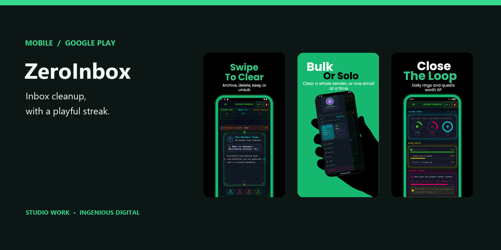
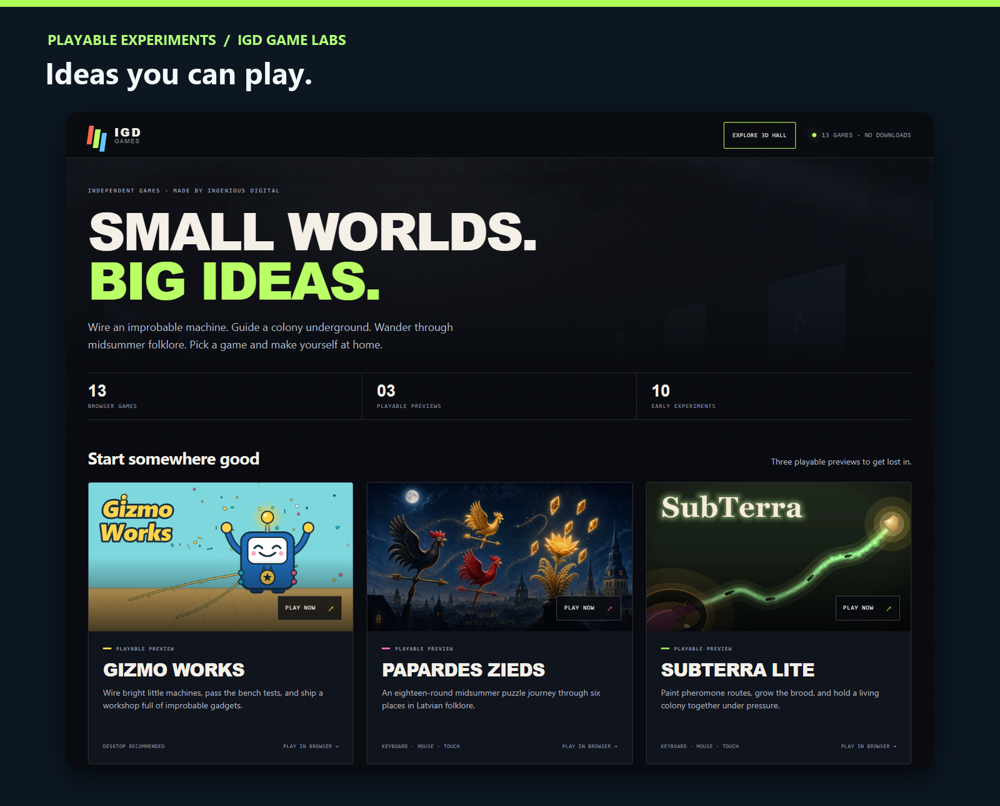
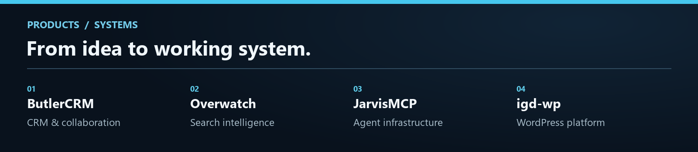
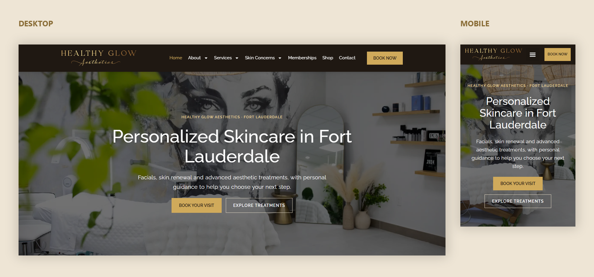
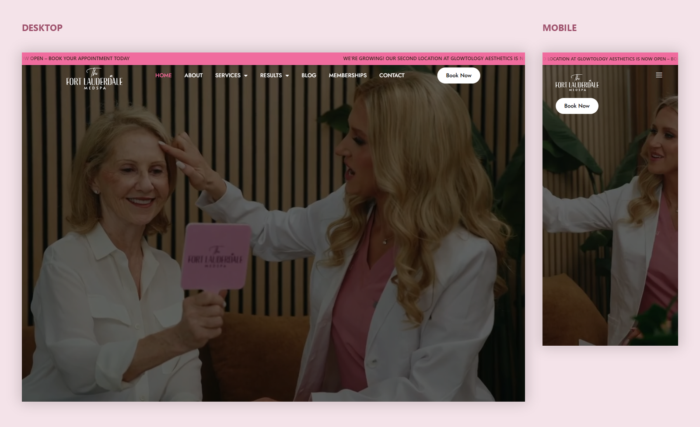
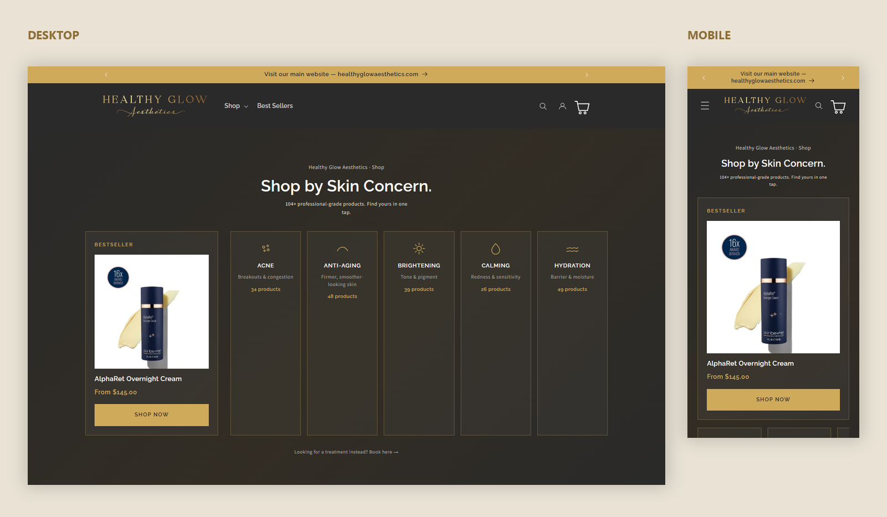

  <picture>
    <source media="(prefers-color-scheme: dark)" srcset="https://raw.githubusercontent.com/PascalAI2024/PascalAI2024/main/assets/header-dark-v4.svg">
    <source media="(prefers-color-scheme: light)" srcset="https://raw.githubusercontent.com/PascalAI2024/PascalAI2024/main/assets/header-light-v4.svg">
    
  </picture>

  

  <a href="https://ingeniousdigital.com"><b>Ingenious Digital</b></a> ·
  <a href="https://github.com/PascalAI2024/portfolio">Selected work</a> ·
  <a href="https://igddev.com">IGD Dev Lab</a> ·
  <a href="https://huggingface.co/x0me">Hugging Face</a> ·
  <a href="mailto:pascal@ingeniousdigital.com"><b>pascal@ingeniousdigital.com</b></a>

---

# Pascal

I'm **Pascal**. I run **[Ingenious Digital](https://ingeniousdigital.com)**, a software and product studio based in Fort Lauderdale. I bring together product thinking, hands-on engineering and technical leadership: from client websites and commerce to CRM, mobile apps, AI infrastructure, data, games and low-level systems.

I like taking an idea from the first useful question through architecture, design, implementation and ongoing improvement. The work below includes my own builds and studio projects made with collaborators; each description identifies my role where it matters.

---

## Tools I work with

**Web & commerce** · WordPress, Shopify, PHP, JavaScript, TypeScript, React, Next.js, Tailwind, HTML, CSS 

**Backend & data** · Elixir, Node.js, Bun, Python, PostgreSQL, SQLite, FastAPI, Phoenix LiveView, SpacetimeDB, LightGBM 

**Systems & embedded** · Rust, Zig, C, C++, CUDA, ESP-IDF, workerd 

**Apps, games & graphics** · Flutter, Dart, Godot, Three.js, Svelte, Luau, Tauri, React Native 

**Infrastructure & tools** · Docker, GitHub Actions, Linux, Bash, PowerShell, Git, Cloudflare, MCP, WireGuard 

---

[Tools](#tools-i-work-with) · [Mobile apps](#mobile-apps) · [Game lab](#igd-game-labs) · [Products](#products-and-systems) · [Client websites](#client-websites) · [Research](#data-research-and-engineering)

## Mobile apps

I led CallCue and ZeroInbox with contributions from Biruk and Mati. The two are listed on Google Play; the other apps are in development or testing.

### [CallCue](https://play.google.com/store/apps/details?id=com.ingeniousdigital.callcue) · live on Google Play

A call planner for follow-ups, holidays and contact campaigns.

### [ZeroInbox](https://play.google.com/store/apps/details?id=com.igddev.zeroinbox) · live on Google Play

A Flutter Gmail cleanup game: group messages by sender, swipe through them and earn progress as you clear your inbox.

### More mobile work · in development or testing

**SilentVoice** explores accessible communication and sign-language research. Translation and device acceptance remain unfinished; no public store release verified.

**[SK8Freak](https://sk8freak.com/)** is a fingerboard community app in development; mobile release unverified.

- **HerCircle** — an app exploring trusted circles and check-ins; public store release unverified.
- **NexusDialer mobile** — a companion communications app in development; public store release unverified.

## IGD Game Labs

The [IGD Games hub](https://games.igddev.com/) showcases browser-game experiments. Studio projects include:

- **Conveyor Idle** — an early warehouse-building prototype featured on the hub.
- **Gizmo Works** — circuit puzzles and working gadgets.
- **SubTerra Lite** — guide an ant colony and its pheromone trails.
- **Papardes Zieds** — puzzles inspired by Latvian folklore.
- **Halligan** — a developing tactical planning prototype.

`TypeScript` · `Phaser` · `PixiJS` · `HTML5` · [Game lab story](https://github.com/PascalAI2024/portfolio/blob/main/case-studies/igd-games.md)

## Products and systems

### [ButlerCRM](https://butlercrm.com/) · customer work in one place

A CRM workspace for relationships, projects and collaboration, with supervised AI workflows. I designed its architecture; access is available by request.

### [Overwatch](https://github.com/PascalAI2024/portfolio/blob/main/case-studies/overwatch.md) · search intelligence and operations

I built Overwatch to bring search performance, analytics and site workflows into one working surface. [Public case study](https://github.com/PascalAI2024/portfolio/blob/main/case-studies/overwatch.md)

### [Asteria](https://tryasteria.com/) · a clearer view of the sky

A birth-chart learning product with an interactive chart. [Explore Asteria](https://tryasteria.com/)

### [NexusDialer](https://nexusdialer.com/) · communications software

Communications software for campaigns, contacts and calling. Its mobile build is in development; public-store release is unverified.

### [JarvisMCP](https://github.com/PascalAI2024/portfolio/blob/main/case-studies/jarvismcp.md) · infrastructure for AI agents

Infrastructure connecting AI agents with tools and workflows. Private source; public case study.

### [igd-wp](https://github.com/PascalAI2024/portfolio/blob/main/case-studies/igd-wp.md) · reusable WordPress platform

I led the systems architecture and technical direction for shared capabilities, releases, testing and maintenance across client sites.

## Client websites

### [Healthy Glow Aesthetics](https://healthyglowaesthetics.com/) · WordPress

Our studio works on this aesthetics practice's WordPress website: service discovery, content, booking pathways, SEO, analytics and ongoing improvements.

[View desktop capture](assets/showcase/healthy-wordpress-homepage-desktop.png) · [View mobile capture](assets/showcase/healthy-wordpress-homepage-mobile.png)

### [The Fort Lauderdale MedSpa](https://thefortlauderdalemedspa.com/) · WordPress

A separate med spa website built by our studio, with service information and a path to booking.

[View desktop capture](assets/showcase/medspa-homepage-desktop.png) · [View mobile capture](assets/showcase/medspa-homepage-mobile.png)

Our local-service website work also includes [Air Duct Cleaning Port St. Lucie](https://airductcleaningpsl.com/), [Clean Quality Air](https://cleanqualityair.com/) and [Cooling Experts](https://coolingexperts.com/).

## Shopify commerce

### [Healthy Glow Shop](https://shop.healthyglowaesthetics.com/) · Shopify

I led the Shopify build for the Healthy Glow store, connecting its shopping experience to the practice's main website. [Case study](https://github.com/PascalAI2024/portfolio/blob/main/case-studies/healthy-glow-shopify.md)

[View desktop capture](assets/showcase/healthy-shopify-homepage-desktop.png) · [View mobile capture](assets/showcase/healthy-shopify-homepage-mobile.png)

## Data, research and engineering

### [Kaggle](https://www.kaggle.com/pascalledesma) · machine learning in the wild

Research and competitions across reasoning, scientific data and agent security. I completed MIT IDSS's Data Science and Machine Learning program in 2025.

### [fplbench](https://github.com/PascalAI2024/fplbench) · forecasts you can score

A leakage-aware Fantasy Premier League dataset and benchmark. Predictions are frozen before the deadline and scored against verified results. `Python` · `LightGBM` · [live board](https://huggingface.co/spaces/x0me/fplbench-board)

### [Maple CUDA](https://github.com/PascalAI2024/maple-preview-windows-cuda) · measuring the fast path

CUDA optimization and benchmark tooling for Maple/llama.cpp. [Benchmarks](https://huggingface.co/datasets/x0me/maple-preview-cuda-benchmarks)

  <picture>
    <source media="(prefers-color-scheme: dark)" srcset="https://raw.githubusercontent.com/PascalAI2024/PascalAI2024/main/assets/bench-dark.svg">
    <source media="(prefers-color-scheme: light)" srcset="https://raw.githubusercontent.com/PascalAI2024/PascalAI2024/main/assets/bench-light.svg">
    
  </picture>

### [ZiggyZag](https://github.com/PascalAI2024/ZiggyZag) · a native Zig shell

An alpha shell workspace with native terminal hosts, a cross-platform launcher and a local AI sidecar. `Zig`

### [JarvisNano](https://github.com/PascalAI2024/JarvisNano) · a voice-first desk companion

ESP32-S3 firmware combining a touch display, voice and device interaction. `C` · `ESP-IDF`

| More public work | Focus |
| :-- | :-- |
| [Qwen Quant Bench](https://github.com/PascalAI2024/qwen38-27b-quant-bench) | Model evaluation |
| [Verrow](https://github.com/PascalAI2024/verrow) | Data quality workbench prototype |
| [KinTunnel](https://github.com/PascalAI2024/kintunnel) | Networking MVP |
| [Selected engineering portfolio](https://github.com/PascalAI2024/portfolio) | Case studies and architecture |

---

## Keep learning

[AI Fluency for Builders](https://verify.skilljar.com/c/me57yu2mc7sq) · [Claude Code in Action](https://verify.skilljar.com/c/d63sf2hoo6gt) · [Introduction to Model Context Protocol](https://verify.skilljar.com/c/jbf57tmrpdb6)

## Let's build something useful

[Ingenious Digital](https://ingeniousdigital.com) · [Selected work](https://github.com/PascalAI2024/portfolio) · [IGD Dev Lab](https://igddev.com) · [Kaggle](https://www.kaggle.com/pascalledesma) · [Hugging Face](https://huggingface.co/x0me) · [Email Pascal](mailto:pascal@ingeniousdigital.com)

Fort Lauderdale · working worldwide

